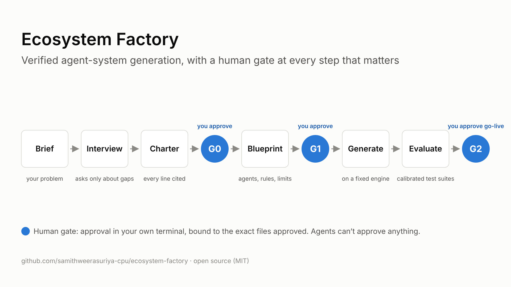
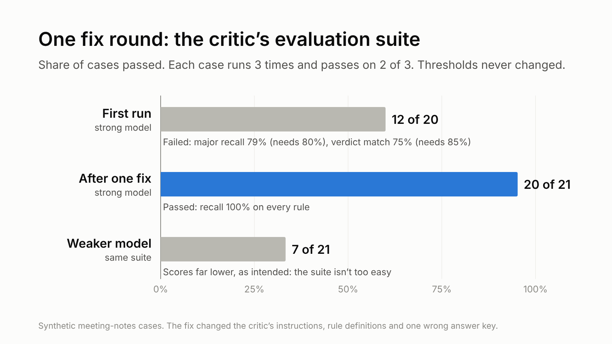

# Ecosystem Factory

**Verified agent-system generation.**



"It seems to work" is not acceptance, yet that is how most agent systems go live. The factory interviews its owner about one problem, designs a small agent system for it, generates that system on a fixed, tested engine, and proves it against calibrated test suites before go-live. A person approves every step that matters, in their own terminal, and agents can't approve anything.

> Read the story behind it: *(article link to follow)*

## How it works

1. **Interview:** an interviewer agent reads your problem brief and asks only about the gaps, a few questions per round.
2. **Charter:** a writer turns the answers into a charter where every line cites its source; a critic and a verifier check it. **G0:** you approve the charter.
3. **Blueprint:** the factory designs the agents, their rules, routes and limits. **G1:** you approve the blueprint.
4. **Generate and prove:** the system is generated on the fixed engine and must pass its evaluation suites. **G2:** you approve go-live.

Each gate approval is bound to the exact files you approved; any later edit voids it.

## What's proven so far

Phase 1 ran a generated agent system on a real job, end to end:

- The job went through its route and was **approved at its human gate** after one review cycle.
- At the gate, the reviewer's one finding was marked **valid**, and **no missed issue** was recorded (one job: a first data point, not yet a rate).
- The whole job used **about 24,000 tokens** in 4 agent calls.

Before that job could run, its reviewer had to pass its evaluation suite. It failed the first time, was fixed once, and passed. Thresholds were never lowered:



The weaker model scoring far lower shows the suite tells good reviewers from poor ones. Every guardrail was also drilled live in a real session, including fail-closed behaviour when the guard hook itself is broken ([docs/drills.md](docs/drills.md)).

## What makes it different

- **Small, fixed routes.** Each generated system is a few agents on a route you can read: author, reviewers, a gate. Every loop has hard caps that the engine enforces, not the agents.
- **Calibrated reviewers.** A reviewer is used only after it passes a test suite with planted defects, near-miss clean twins, hidden answer keys and 3 runs per case. The suite must also beat a weaker model, or it is too easy to count.
- **Bound to exact versions.** Approvals and evaluation passes each record the fingerprints of the files they cover. Change an approved file and its approval is void; change an agent, a rule, a test case or an answer key, and the earlier evaluation pass no longer counts.
- **Claims checked against sources.** Charter lines cite the owner's answers or registered files; quotes must match word for word.
- **Humans decide.** Gate commands are human-only and run in the owner's own terminal; the agents' guard blocks them.

More detail in [docs/overview.md](docs/overview.md).

## Status

| Phase | Status |
|---|---|
| 0. Foundation | Phase accepted |
| 1. Thin end-to-end version | Phase accepted |
| 2. Intake | In progress: the intake agents, their route and the evaluation machinery are tested; their evaluation cases and live runs are next |
| 3. Design | Planned |
| 4. Generation and lifecycle | Planned |
| 5. Autonomy, on evidence | Planned |

As of 2 November 2026:

- **Unit and end-to-end tests:** 616 automated tests pass (no model calls; agents are simulated).
- **Model evaluations:** Phase 1's reviewer passed 20 of 21 cases and its writer 5 of 5 (3 runs per case). The Phase 2 suites are designed; they have not been run yet.

Labels and details: [docs/roadmap.md](docs/roadmap.md).

## How it was built

Samith, a product manager who does not write code, specified, reviewed and decided every step. Claude Code wrote, ran and tested all of the code. The working rules, in brief:

- **One task at a time:** plan, approval, build, a check run in front of Samith, a build-log row, a commit.
- **Tests before every commit** that touches the engine or its rules.
- **Never weaken a test or a threshold** to make it pass; report the failure instead.
- **No secrets, no real work data:** synthetic or public material only. A publish check blocks commits that break this.
- **Only Samith approves gates and publishes.** The guard blocks the agents from both.

Mistakes found along the way are kept as lessons: [docs/lessons.md](docs/lessons.md). The engine and method are derived from the author's earlier private labs; the role catalogue credit is in [NOTICE.md](NOTICE.md).

## Try it

Requirements: Windows with Python 3.13 (via `uv`) and the `py` launcher, Git, and Claude Code on a claude.ai subscription. No API key is needed: every agent call stays on the subscription.

Set up the environment:

```bash
uv venv --python 3.13 .venv
```

```bash
uv pip install --python .venv jsonschema
```

Check the whole setup:

```bash
.venv\Scripts\python.exe engine\doctor.py
```

Run the tests (the fast tier takes 10 to 25 minutes, depending on the machine):

```bash
.venv\Scripts\python.exe engine\run_tests.py --fast
```

Then open the folder in Claude Code (manual permission mode only) and start an intake:

```
/onboard
```

Gate actions (`engine/gate.py`) run only in your own terminal.

## What this is, and what it isn't

It **is** a factory for small, purpose-built agent systems: it interviews its owner about one problem, designs a few agents with their rules and gates, generates them on a fixed engine, and proves them with evaluations before they go live.

It **isn't** a dependency-graph tool or a general agent swarm. Each generated system is small, has a fixed route and hard caps, and is approved by a person at every gate.

## Scope and non-goals

- **Scope:** one user, on one local Windows machine, running Claude Code on a Claude subscription.
- **Not** a concurrent or hosted service: one job runs at a time, for one approver.
- **Not** enterprise isolation, multi-tenant security or compliance tooling.
- **Not** a multi-repository code generator: it generates small agent ecosystems, each in its own folder.

## More

- [Roadmap](docs/roadmap.md): phases and their status
- [Overview](docs/overview.md): the architecture and the guarantees
- [Lessons](docs/lessons.md): what broke, and what changed because of it

## Licence

MIT, see [LICENSE](LICENSE).
